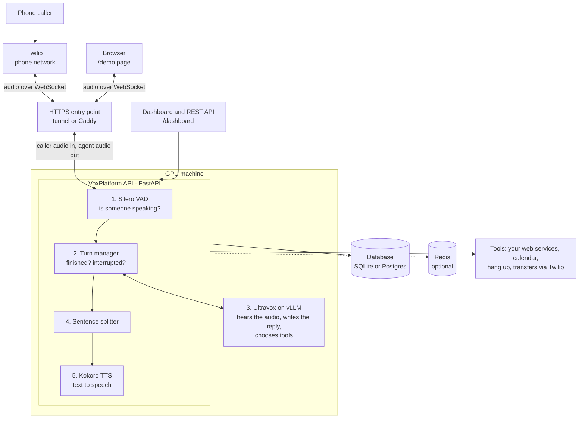

# VoxPlatform

A self-hosted AI voice agent platform. Callers talk to an AI agent over the phone or in a browser, and it answers in
real time, can be interrupted, and can call your tools (check a calendar, book a slot, transfer the call, hang up).
It runs on open-source parts only, on a GPU you control, with no calls to the paid Ultravox API:

- **Ultravox v0.6** (Qwen3-32B) listens to speech and writes the reply, served by **vLLM**
- **Kokoro-82M** speaks the reply, **Silero** detects when someone is talking
- **Twilio** connects phone calls (optional; the browser demo needs no phone)

> **Honest status:** this repo does not claim to beat the paid service. See [docs/FINDINGS.md](docs/FINDINGS.md) for what was
> measured, what was only written, and what is unproven.

---

## How it fits together



**Following one call:** the caller speaks, and the audio reaches the API. Silero spots speech and the turn manager waits
until the caller has finished (or lets them interrupt the agent mid-sentence). The audio goes straight to Ultravox,
which understands it and writes the reply, calling a tool if needed. The reply is split into sentences, Kokoro turns
each sentence into speech as soon as it is ready, and the audio streams back to the caller. The database keeps
transcripts and usage; Redis is only needed when running several API servers.

---

## 1. Call it (phone)

**Phone number: `+1 XXX XXX XXXX`** <!-- TODO: replace with your Twilio number -->

Say: *"Hi, I'd like to book an appointment."* The agent is a dental-clinic receptionist. It can check
availability, read the day and time back to you, and book once you say yes. Interrupt it mid-sentence to see
barge-in. Say *"goodbye"* and it hangs up.

The number only answers while the stack is running on a GPU machine (steps below). If it says "application error",
the server is off: start it with section 3.

---

## 2. Try it in 2 minutes (no GPU, no phone, fake models)

This runs the real API, dashboard and browser page with stand-in models, so you can see how everything fits together.
The "agent" replies with canned text; it does not understand you.

```bash
git clone https://github.com/Aravind-11/voxplatform.git
cd voxplatform
python3 -m venv .venv && source .venv/bin/activate
pip install fastapi "uvicorn[standard]" httpx pydantic python-multipart numpy scipy openai

VOX_ADMIN_KEY=my-admin-secret python tests/e2e/serve_fake.py 8080
```

In a second terminal, create an account and an agent:

```bash
# 1. create a tenant (an account). The response contains your API key: save it, it is shown once.
curl -s -X POST localhost:8080/admin/tenants -H "X-Admin-Key: my-admin-secret" \
     -H 'content-type: application/json' -d '{"name":"me"}'
# -> {"tenantId":"tnt_...","apiKey":"vox_..."}

# 2. create an agent
export KEY=vox_...            # paste your key
curl -s -X POST localhost:8080/v1/agents -H "X-API-Key: $KEY" -H 'content-type: application/json' -d '{
  "name": "helper",
  "systemPrompt": "You are a friendly assistant. Answer in one or two short sentences.",
  "greeting": "Hello! How can I help?",
  "tools": ["hangUp"]
}'
```

Open **http://localhost:8080/demo**, paste your API key, pick the agent, press Start, and allow the microphone
(headphones recommended). Open **http://localhost:8080/dashboard** to see calls, transcripts, usage and keys.

---

## 3. Run it for real (GPU + real models + phone)

### What you need
| | |
|---|---|
| GPU | One 80 GB card (tested: 1x H100 on Lambda Cloud). Ultravox 32B fp8 needs about 40 GB plus room for speech |
| OS | Ubuntu 22.04/24.04, Python 3.10+, `tmux`, `curl` |
| Disk | ~80 GB for model weights (download once, reuse) |
| Hugging Face | An account is enough; the models are public |
| Phone (optional) | A [Twilio](https://www.twilio.com) account with a voice-capable number, its **Account SID** and **Auth Token** |

### Steps (run on the GPU machine)
```bash
git clone https://github.com/Aravind-11/voxplatform.git && cd voxplatform

bash scripts/00_setup.sh          # 1. Python env + vLLM (about 5-10 min)
bash scripts/02_fetch_extra.sh    # 2. API dependencies, Kokoro voice, Silero VAD
bash scripts/03_fetch_models.sh   # 3. downloads Ultravox + helpers (~70 GB, once)

tmux new -d -s vllm "bash scripts/01_serve_vllm.sh"   # 4. start the model server
# wait until this prints a JSON model list (2-5 min after start):
curl -s localhost:8000/v1/models

# 5. start the platform. For phone calls, set these first (all optional; skip for browser-only):
export TWILIO_ACCOUNT_SID=ACxxxxxxxx
export VOX_TWILIO_NUMBER=+1XXXXXXXXXX      # your Twilio number
bash scripts/deploy.sh             # asks for the Twilio Auth Token (hidden, never saved)
```
`scripts/00..03` default to a Lambda persistent filesystem at `/lambda/nfs/arvi`. On another provider set
`FS=/some/path` before each script (a plain folder is fine).

`deploy.sh` opens a public HTTPS tunnel, starts the API, creates an account and a receptionist agent, points your
Twilio number at it, and prints:

```
Dashboard:    https://<random>.trycloudflare.com/dashboard
Browser demo: https://<random>.trycloudflare.com/demo
API key:      vox_...        <- save it, shown once
Agent id:     agt_...
Phone:        +1XXXXXXXXXX now routes to the agent. Call it.
```

**Call the number.** Or open the browser demo link, paste the API key and talk. The tunnel URL changes every
time you restart, which is why `deploy.sh` re-points the Twilio number for you. For a permanent address use
section 5 (Docker) with your own domain.

### Make your own agent
```bash
export URL=https://<random>.trycloudflare.com KEY=vox_...
curl -s -X POST $URL/v1/agents -H "X-API-Key: $KEY" -H 'content-type: application/json' -d '{
  "name": "support",
  "voice": "af_heart",
  "greeting": "Thanks for calling Acme. How can I help?",
  "systemPrompt": "You are Acme support. Be brief. If the caller wants a human, transfer them.",
  "tools": [
    "hangUp",
    {"builtin": "transfer", "targets": {"billing": "+15551234567"}}
  ]
}'
```
Then point a Twilio number at `https://<your host>/twilio/voice/<agent id>` (HTTP POST), or
`TWILIO_ACCOUNT_SID=AC... TWILIO_AUTH_TOKEN=... python scripts/twilio_set_webhook.py +1XXXXXXXXXX https://<your host>/twilio/voice/<agent id>`.

### Have the agent call someone (outbound)
```bash
curl -s -X POST $URL/v1/calls/outbound -H "X-API-Key: $KEY" -H 'content-type: application/json' -d '{
  "agentId": "agt_...", "to": "+1YYYYYYYYYY",
  "voicemailMessage": "Hi, this is Acme returning your call. Please call us back."
}'
```
Capped at 50 calls per account per day by default (`VOX_OUTBOUND_PER_DAY`). Twilio trial accounts can only call verified numbers.

### Let the agent call your own web service (tools)
```json
{"name": "lookup_order", "description": "Find an order by its number.",
 "parameters": {"type": "object", "properties": {"order_id": {"type": "string"}}, "required": ["order_id"]},
 "http": {"url": "https://api.example.com/orders", "method": "POST", "headers": {"Authorization": "Bearer ..."}},
 "confirm": false}
```
Put that object in an agent's `tools` list. More in [docs/TOOLS.md](docs/TOOLS.md).

### Stop
`tmux kill-server`, then terminate the GPU instance. Weights stay on the persistent folder, so the next start skips
step 3. The phone number rings into nothing until you run `deploy.sh` again on a new machine.

---

## 4. Troubleshooting
| Symptom | Fix |
|---|---|
| `deploy.sh`: "vLLM is not answering on :8000" | Step 4 is still loading. `tmux attach -t vllm`, wait for "Application startup complete" |
| Phone says "application error" | Server or tunnel is down. Re-run `bash scripts/deploy.sh` (it fixes the webhook) |
| Call connects, silence | `tmux capture-pane -p -S -300 -t api \| tail -60` and look for `ERROR` |
| Agent mishears a name or time | Expected sometimes on phone audio. Use `{"tool": "book_slot", "confirm": true}` so it reads details back first |
| Twilio trial: can't call a number | Verify the destination in the Twilio console |
| HTTP 401 | Use `X-API-Key` for `/v1/*`, `X-Admin-Key` for `/admin/*` |

## 5. Production (own domain, 2+ servers, alerts)
```bash
cp deploy/env.example deploy/.env      # set your domain, secrets, passwords
bash deploy/up.sh                      # Caddy (HTTPS) -> api1 + api2 -> Postgres, Redis, Prometheus, Alertmanager, Grafana
```
The platform runs two API nodes behind a health-checked load balancer, shares call caps through Redis, and alerts on 9 rules
(node down, high latency, capacity, errors). A node killed mid-call drops only its calls; the phone carrier is told to reconnect the caller
to another node with the transcript so far. Tested with real processes (`tests/e2e/ha_test.py`, 21 checks, fake models).
**The Docker images and Kubernetes manifest were never built or run** (container registries are blocked in the build environment).
Kubernetes: `deploy/k8s/voxplatform.yaml` (autoscale on the per-node `vox_active_calls` gauge, about 20-24 per node). See [docs/OPERATIONS.md](docs/OPERATIONS.md).

## 6. Run the tests (no GPU)
```bash
pip install -r requirements-dev.txt && pytest          # 240+ unit tests
```

## 7. Technical documentation
| Doc | What is in it |
|---|---|
| [docs/ASSESSMENT.md](docs/ASSESSMENT.md) | Engineering assessment: reuse vs build, architecture, cost per minute, scaling, plan, risks, proof-of-concept report |
| [docs/INTEGRATION.md](docs/INTEGRATION.md) | OpenAPI tool import, call variables, signed webhooks, VoxSun adapter design |
| [docs/LANGUAGES.md](docs/LANGUAGES.md) | Supported languages, voices, licence caveats |
| [docs/FINDINGS.md](docs/FINDINGS.md) | Measured latency and capacity, cost vs. the paid service, what is not proven |
| [docs/STATUS.md](docs/STATUS.md) | Every capability labelled verified / written / designed |
| [docs/PARITY.md](docs/PARITY.md) | Feature-by-feature comparison with Ultravox Realtime |
| [docs/TOOLS.md](docs/TOOLS.md) | Tool definitions, built-ins (hangUp, transfer, DTMF, voicemail, knowledge base) |
| [docs/OPERATIONS.md](docs/OPERATIONS.md) | Secrets, recording and retention, roles, monitoring, scaling, draining |
| [docs/TUNING.md](docs/TUNING.md) | Turn-taking and latency settings |
| [docs/LICENSES.md](docs/LICENSES.md) | Every component's license (commercial use) |

Cost estimate: `python scripts/cost_model.py`. Resource logging on a GPU box: `scripts/resource_log.sh`.

Not built: billing/sign-up, VoxSun integration, SIP trunking (Twilio is the phone layer), voice cloning, single sign-on.

Code layout: `core/` (turn-taking, VAD, speech, session), `transports/` (Twilio, browser), `api/` (REST, WebSocket,
dashboard, storage), `scripts/` (setup and deploy), `deploy/` (Docker, Kubernetes), `tests/`.
