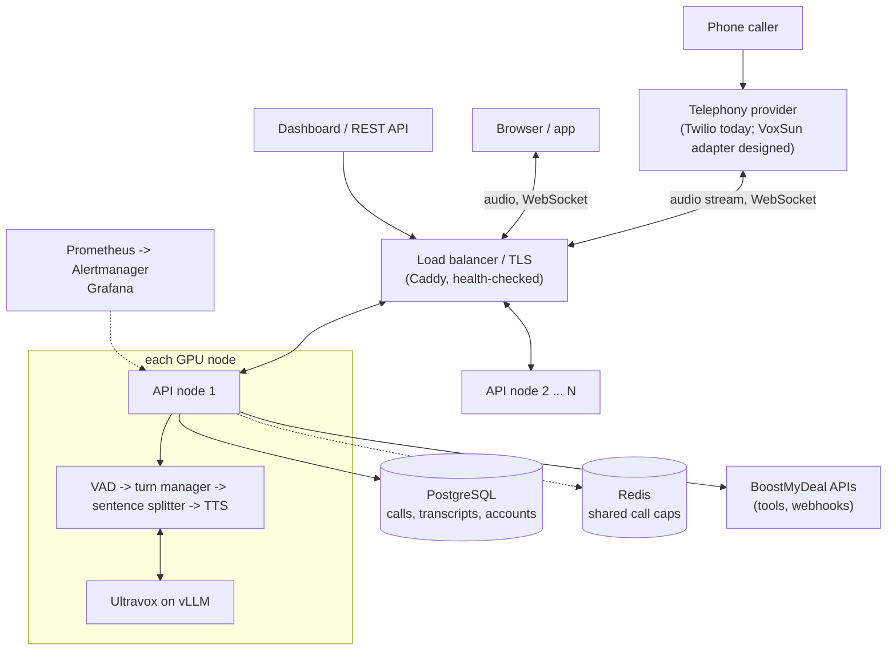

# Engineering assessment: a self-hosted real-time voice AI engine on open-source Ultravox

Written 2026-10-16. This answers the brief section by section. Every number is labelled:
**measured** (I ran it, result shown), **estimated** (arithmetic or judgment from stated inputs), **designed** (written down, not built),
**not tested** (built but never exercised for real). Nothing here claims the engine is better than a paid voice AI service: that was never measured.

## 0. Summary

| Question | Answer |
|---|---|
| Can it be done on open-source parts, without the paid Ultravox API? | **Yes, shown at proof-of-concept level.** Ultravox v0.6 (MIT) on vLLM, Kokoro-82M speech (Apache-2.0), Silero VAD (MIT), our own gateway, sessions, tools and operations layer. A real inbound phone call, interruption, a live tool call and a load test were run on one H100. |
| Latency | **Measured**: median ~870 ms from the caller finishing to the first agent audio on a real call (server side, 650-1,020 ms range). Excludes the phone network. |
| Capacity | **Measured, synthetic callers**: 24 simultaneous calls per H100 comfortably (95th percentile 1.7 s), 32 usable (2.25 s), 48 degraded (5.9 s). |
| Cost | **Estimated**: about $0.014-0.020 per call-minute (GPU plus phone line) at 25-100 peak calls if the GPUs are half used on average; about $0.03 if only a quarter used (table in section 3), against the $0.05 paid price in the brief. The paid service is cheaper below about 2.3 average simultaneous calls (with two nodes for failover). |
| Quality | **Not shown equal to a paid service.** Real callers were mis-heard 3 times on live calls; a mitigation exists (read-back before acting) and is unproven live. No side-by-side with the paid service was run. |
| Production readiness | **Not yet.** It is a working, tested pilot platform. The gaps and the plan to close them are in sections 7-9. |
| Recommendation | Proceed to a **pilot** behind three gates: (1) VoxSun's audio interface specification, (2) BoostMyDeal's API specifications, (3) an accuracy and quality test on BoostMyDeal's own call recordings next to the paid service. If gate 3 fails, the cost advantage does not matter. |

The brief asks for two things: an assessment (sections 1-9 here) and a proof of concept (section 10). VoxSun integration is **not built or tested** (no access to VoxSun); section 5 designs it.

## 1. What is reused and what is built

| Layer | Reused (open source) | Licence | Built here | State |
|---|---|---|---|---|
| Speech-understanding model | Ultravox v0.6 (`fixie-ai/ultravox-v0_6-qwen-3-32b`): takes caller audio directly, no separate speech-to-text step | MIT (model card) | thin client: audio parts, streaming tool-call assembly, a side request that writes the transcript, a guard against non-transcript answers | measured |
| Model serving | vLLM (fp8, OpenAI-compatible server, tool-call parser) | Apache-2.0 | start script, health checks | measured |
| Text-to-speech | Kokoro-82M + misaki (grapheme-to-phoneme) | Apache-2.0 | sentence splitter, just-in-time synthesis, per-language pipelines, speed control | measured (English); other languages written, not run |
| Voice activity | Silero VAD | MIT | frame wrapper | measured |
| Turn-taking | none (model-based end-of-turn probability exists in Ultravox's prompt API) | n/a | silence-based turn manager with speculate / commit / resume, optional model end-of-turn verdict, barge-in with history trimmed to what the caller heard | measured (barge-in 3/3), thresholds untuned on real speech |
| Telephony | Twilio Media Streams (commercial service, pay per use) | commercial | transport: 8 kHz G.711 mu-law codec, resampling, marks, DTMF in/out, webhook signature check, transfer, outbound, voicemail, call recovery | inbound measured once; the rest not tested live |
| Browser audio | Web Audio API | n/a | WebSocket transport and demo page | tested in headless Chromium |
| Sessions and state | none | n/a | per-call state machine; call, transcript and usage records in PostgreSQL or SQLite; shared per-account call cap in Redis | tested against real Postgres and Redis |
| Tools | none | n/a | HTTP tools with static / dynamic / automatic parameters, OpenAPI import, built-ins (hang up, transfer, DTMF, voicemail, knowledge base), read-back-before-acting, SSRF guard | 239 unit tests; 18/20 correct on real model with audio |
| Accounts and control | none | n/a | multi-account API, key roles, audit log, usage and cost, retention, recording | tested |
| Operations | Caddy, Prometheus, Alertmanager, Grafana, Postgres, Redis (all open source) | Apache-2.0 / AGPL for Grafana (check before redistributing) / BSD | compose and Kubernetes manifests, alert rules, dashboard, drain, readiness checks | HA topology run as processes; images not built |
| Not reused, not built | SIP/RTP stack, voice cloning, single sign-on, billing | | | not built (section 9) |

One licence flag: Kokoro's English front end can fall back to **espeak-ng (GPL-3.0)**. The default configuration runs without it (`VOX_NO_ESPEAK=1`);
Spanish, French, Italian, Portuguese and Hindi voices need it, so they are off by default. Get legal advice before enabling them in a distributed product. Details: `docs/LICENSES.md`.
Grafana is optional and AGPL-3.0; running it internally is the usual case, but check your use.

## 2. Architecture

- **Audio transport.** Telephony audio arrives as 8 kHz mu-law frames over a WebSocket (Twilio Media Streams) and is converted to 16 kHz for the model; replies are synthesized at 24 kHz and converted back. Browsers use 16 kHz in / 24 kHz out. Any other carrier needs an adapter with the same small interface (section 5).
- **Model serving.** One vLLM process per GPU node serves Ultravox in fp8; each node also runs the API process(es) that own the calls. A node is self-contained, so capacity grows by adding nodes.
- **TTS.** Kokoro runs inside the API process. Only the first sentence is synthesized eagerly; later sentences are synthesized just in time, which removed TTS as the bottleneck up to ~16 calls (measured).
- **Session management.** One state machine per call: VAD frames feed a turn manager that starts a reply speculatively when the caller pauses, commits when the pause is long enough (or a model verdict says the caller is done), and aborts and resumes if the caller continues. Interruptions stop playback within about 225 ms (measured) and the conversation history keeps only what the caller heard. State that must survive a node (transcript, call record, caps) lives in Postgres and Redis, not in the node.
- **Tool calling.** The model proposes a call; the platform runs it only after the turn is committed (never for a speculative reply). Tools are HTTP calls to your own endpoints with credentials the model never sees, public-address-only URLs (SSRF guard), no redirects, timeouts and size limits. Tools that change data can require a read-back and a spoken "yes" in a later turn, so a misheard day or name becomes an audible question instead of a silent action.
- **Failure recovery.** A health check on every node (database and Redis included) takes a sick node out of rotation; a drained node finishes its calls; if a node dies mid-call, the telephony layer's next instruction reconnects the caller to another node with the transcript so far (up to twice per call); the dead node's cap slots expire by themselves. Tested with real processes and a killed node (section 10); the Twilio side of the reconnect is simulated.

## 3. Compute and cost per active call-minute

**Compute (measured):** one 80 GB H100 runs Ultravox 32B in fp8 (vLLM given 60% of GPU memory) plus Kokoro and Silero, and carried 24 simultaneous calls comfortably, 32 usable. The limit was text-to-speech throughput, not the model.
**Resource consumption (host CPU, GPU utilization, memory) was not logged during those runs.** `scripts/resource_log.sh` records it into a CSV for the next GPU session; until then treat those figures as unknown.

**Cost (estimated; arithmetic in `scripts/cost_model.py`):** inputs are third-party prices (Lambda H100 PCIe $2.86/h, Twilio US inbound $0.0085/min; neither read from the provider's own page) and the $0.05/min paid price from the brief (what it includes is unknown).
GPUs are sized for the peak (24 calls each, plus one spare, never fewer than two) and run around the clock; minutes come from the average.

| Peak simultaneous calls | Average / peak | GPU nodes | GPU $/month | GPU $/call-min | + phone line | vs $0.05 |
|---|---|---|---|---|---|---|
| 10 | 50% | 2 | $4,176 | $0.0191 | $0.0276 | 1.8x cheaper |
| 25 | 50% | 3 | $6,263 | $0.0114 | $0.0199 | 2.5x cheaper |
| 100 | 50% | 6 | $12,527 | $0.0057 | $0.0142 | 3.5x cheaper |
| 200 | 50% | 10 | $20,878 | $0.0048 | $0.0133 | 3.8x cheaper |
| 500 | 50% | 22 | $45,932 | $0.0042 | $0.0127 | 3.9x cheaper |

(25%, 80% and the other peaks: run the script.) **The paid service is cheaper until you average about 2.3 simultaneous calls** (about 100,000 call-minutes a month) with two nodes; one node alone would break even at 1.1, but one node has no failover.
Not included: engineering and on-call time, the database and proxy hosts, storage, bandwidth, Twilio Media Streams fees, the cost of any quality gap, and any discount from reserved or spot GPUs (which would lower the GPU line).
**Cost control in the product:** per-account concurrent-call caps (shared across nodes through Redis), outbound-call daily caps and country allow-lists, per-account rates with usage and cost reports (also CSV), alerts on capacity, data retention, and call-level usage records. Hard spending limits per account and billing are not built.

## 4. Latency, speech quality, reliability, limitations

| Item | Value | Status |
|---|---|---|
| Caller stops speaking -> first agent audio, real phone call, server side | median ~870 ms, range 650-1,020 ms (first cold turn 1.6 s) | **measured**, one call, 10 replies |
| Of which end-of-turn wait | ~640 ms | measured (configurable; a model verdict can shorten it when confident) |
| Same measure under load, 16 / 24 / 32 / 48 simultaneous synthetic callers (p50 / p95) | 1.0 / 1.5 s, 1.4 / 1.7 s, 1.8 / 2.3 s, 3.7 / 5.9 s | **measured**, all callers speaking at once (worst case) |
| Interruption: caller speaks -> agent silenced | ~225 ms; 3 of 3 | **measured** |
| Phone network and carrier legs | typically add 100-300 ms each way in practice | **estimated**, not measured |
| Perceived response time on a phone call | roughly 1.0-1.4 s | **estimated** (server median + network) |
| Speech quality | Kokoro-82M is intelligible and natural enough for scripted business calls, below the best commercial voices; English is the only language ever heard on the stack | **not measured** (no listening test, no MOS) |
| Understanding real callers | 3 mis-hearings across live calls; synthetic-speech word error 0.3% does not predict it; tool selection from audio 18/20 | **measured**, tiny and informal |
| Tool-call safety | read-back before acting is unit-tested; never run live | **not tested live** |
| Reliability over time | none claimed: no soak test | **unknown** |

**Likely limitations.** (1) A 32B open model of this vintage is behind the newest commercial models in reasoning and robustness, and Ultravox v0.6 will age; upgrading means re-testing. (2) Kokoro has no voice cloning and fewer voices; non-English voices are unproven. (3) The audio-in model can mis-hear names, numbers and dates; confirmation steps are the control, not the cure. (4) One GPU's capacity is limited by TTS throughput; more is possible with batching or process-level scaling (`tests/bringup/tts_procs.py`, not run). (5) A node loss ends the call on that node; recovery relies on the telephony provider following a redirect, which is verified only against a simulation. (6) Whisper-class audio encoders handle many languages, but accuracy per language is unmeasured here.

## 5. Integration points

### BoostMyDeal APIs (built; their real endpoints not seen)
The boundary is HTTP in both directions, with credentials held by the platform:
- **Platform -> BoostMyDeal (during a call):** tools. `POST /v1/tools/import-openapi` turns an OpenAPI 3 document into one tool per operation (path and query parameters, JSON bodies, auth headers stored write-only; non-GET operations require read-back by default). Call facts (`callId`, caller and callee numbers) can be added automatically; fixed values (account ids) can be pinned so the model cannot change them.
- **BoostMyDeal -> platform (starting calls):** `POST /v1/calls` (browser/app) and `POST /v1/calls/outbound` (phone) with `agentId`, **`variables`** (customer name, deal id, offer text; filled into `{{placeholders}}` in the prompt and greeting) and `metadata` (any ids to get back later). Missing variables are rejected before the call starts.
- **Platform -> BoostMyDeal (after a call):** a signed webhook (`call.started`, `call.ended`) carrying duration, end reason, metadata and the full transcript, so the CRM can log the outcome.
- Details, examples and a hypothetical sample API: `docs/INTEGRATION.md`.

### VoxSun audio/call infrastructure (designed, not built, not tested)
I have no VoxSun documentation or access, so **everything here is an assumption to confirm**. The engine needs a transport adapter (~200 lines, modelled on `transports/twilio.py`) implementing: receive caller audio frames; send agent audio frames; clear queued audio on interruption; end the call; optional DTMF. Questions to answer first:
1. How is audio delivered: WebSocket media stream, SIP/RTP, or an SDK? (SIP needs a SIP stack we have not built.)
2. Codec and sample rate (G.711 8 kHz? Opus? 16 kHz PCM?), frame size, and whether frames are timestamped.
3. Barge-in: can queued outbound audio be flushed (needed for interruption)?
4. Call lifecycle: how do we learn the call started, ended, or failed, and can VoxSun re-route a call if our stream drops (the recovery feature depends on it)?
5. Authentication of VoxSun to us and of us to VoxSun; network path (public internet or private link).
6. Test access: a test number or call generator.
Time for the adapter once those are answered: about 1-2 weeks including a test call (estimate).

### Security boundaries
TLS at the proxy only (nodes are on a private network). Accounts are isolated by an account id on every query (tested for cross-account access). API keys are stored as hashes, have roles (admin, developer, viewer), can be rotated and revoked, and every change is audited. Tool credentials are write-only. Tools cannot reach private or internal addresses. Phone webhooks are signature-checked and fail closed. `/metrics` needs a token and is not exposed publicly. Recording is opt-in per agent. **Known risks:** caller speech can attempt prompt injection against tools (mitigated by read-back and fixed parameters, not eliminated); the DNS-rebinding race on tool URLs (production should add an egress proxy); no external penetration test.

## 6. Scaling from pilot to hundreds of concurrent calls

The unit of scale is a **GPU node** (vLLM + API process) carrying ~24 calls. State is shared (Postgres, Redis), any node can take any call, and the proxy health-checks nodes. This design was exercised with two nodes (section 10); beyond that the scaling is arithmetic plus the measured per-node limit.

| Stage | Concurrent calls | Nodes | What changes | Gate to move on |
|---|---|---|---|---|
| Pilot | up to ~24 | 2 (one spare) | one environment, managed Postgres, real domain | accuracy and latency targets met on real calls; 72 h soak |
| Early production | 25-100 | 3-6 | autoscaling on `vox_active_calls` (target ~20 per node), rolling updates with drain | multi-node load test at 100; failover drill passed |
| Scale | 100-500 | 6-22 | split TTS to dedicated workers or batch it; read replicas or partitioning for transcripts; second region for resilience | cost per minute and p95 latency at target; capacity alerts quiet for a month |

Bottlenecks in the order they will bite: **text-to-speech throughput** per node (measured); **GPU memory for concurrent contexts** (mitigated by the 8k context limit; not stress-tested); **model start-up time** (minutes, so keep a warm spare and scale ahead of demand); **database write rate** for transcripts (small per call; not tested at 500 calls); **Redis** is on the call-start path only. Cold GPU capacity from a cloud provider may not be available on demand at peak: reserve a floor. Assumption flagged: that 24 calls per node stays true with real callers and the model-based end-of-turn check switched on (unmeasured; the latter adds a model call per pause).

## 7. Phased plan (estimates, for a team of 2-3 engineers; they move with what the gates show)

| Phase | Weeks | Work | Exit criteria |
|---|---|---|---|
| 0. Gates | 1-2 | VoxSun interface spec and test access; BoostMyDeal API specs; define success metrics; collect 100+ real call recordings; run the same scripts through the paid service as a baseline | metrics agreed; baseline numbers exist |
| 1. Pilot build | 3-4 | VoxSun adapter; BoostMyDeal connectors via OpenAPI import; tune turn-taking and read-back flows on real recordings; validate target languages with native speakers; staging on 2 nodes with domain, TLS, alerts | proof of concept on a VoxSun test call with measured latency, resources and cost; word-error and task-success within the agreed margin of the baseline |
| 2. Hardening | 4-6 | 72 h soak; failover and recovery drills against the real carrier; multi-node load test (100 calls); security review and penetration test; runbooks; alert tuning; canary on 5-10% of real traffic | no unexplained errors in soak; recovery works on the real carrier; target SLOs met on canary |
| 3. Scale and improve | 6-10 | autoscaling; TTS batching or dedicated workers; recording-based evaluation loop; model upgrade path and A/B against the paid service; cost dashboards | hundreds of concurrent calls at target latency and cost |
Total to confident production at hundreds of calls: roughly **4-6 months** (estimate). The largest uncertainty is Phase 1's accuracy result and VoxSun's interface.

## 8. Risks

| Risk | Likelihood / impact | Mitigation |
|---|---|---|
| Open model mishears real callers more than the paid service does | high / high | gate 3 before committing; confirmation steps; recorded-speech evaluation loop; model upgrade path |
| VoxSun interface is SIP-only or has no audio flush | unknown / high | answer the six questions first; budget SIP work if needed |
| Model ages; upgrades regress behaviour | medium / medium | pinned versions; regression suite on recorded calls |
| GPU supply or price changes | medium / medium | reserve a floor; keep the stack portable (containers, any cloud) |
| Licence change or GPL contamination (espeak-ng) | low / high | keep `VOX_NO_ESPEAK=1`; licence review before enabling extra languages |
| Prompt injection via caller speech into tools | medium / high | read-back on all state-changing tools; fixed parameters; least-privilege API credentials |
| Recording and privacy rules (consent, retention) | medium / high | consent line in greeting, retention settings, deletion endpoint; legal review |
| Dependency on one telephony provider | medium / medium | adapter interface; VoxSun adapter removes it |
| Node failure drops a call before recovery works on the real carrier | medium / medium | drills in Phase 2; alert on every reconnect |
| Cost advantage disappears at low volume | high at pilot scale / low | accept pilot cost as the price of learning; see break-even |

## 9. Team skills required

Real-time backend (Python asyncio, WebSockets, audio codecs); telephony/VoIP (SIP, RTP, carrier interop; VoxSun specifics); ML serving (vLLM, quantization, GPU memory); SRE (containers, Kubernetes or Compose, Prometheus, GPU capacity); speech/conversation evaluation (word-error measurement, scripts, native reviewers for each language); security and privacy (call-recording law, penetration testing). **Not built:** SIP trunking, voice cloning (no verified commercially licensed model; needs a consent flow), single sign-on, billing and self-serve sign-up (a credit ledger and Stripe helpers exist as groundwork but are not wired in).

## 10. Proof-of-concept report (brief section 7)

| Requirement | What was done | Result | Status |
|---|---|---|---|
| Self-hosted real-time conversation | Ultravox on vLLM + Kokoro + Silero on one H100; real inbound call through Twilio and a tunnel | worked; 10 replies in one call | measured |
| Connected to a VoxSun test call | **not done**: no VoxSun access | a Twilio call was used as the stand-in for the same audio path | not done |
| Interruption handling | barge-in on the live call | 3 of 3; agent silenced in ~225 ms; history trimmed to what was heard | measured |
| At least one live business-tool invocation | check-availability and book-slot tools against a demo calendar, called by the real model from audio | 18/20 correct tool and arguments in the audio test; on the live call the tool ran, but one live mis-hearing led to a wrong booking, which is why read-back confirmation was added | measured (tool), mitigation not tested live |
| Measured latency | see section 4 | median ~870 ms server side | measured |
| Resource consumption | **not logged** during the runs | `scripts/resource_log.sh` ready for the next session | not done |
| Cost | arithmetic from cited inputs | section 3 | estimated |
| Capacity | synthetic load test, 1-48 calls | section 4 | measured |
| Failure recovery and scale-out topology | two nodes behind a load balancer with Postgres, Redis, Prometheus, Alertmanager; a node killed mid-call (`tests/e2e/ha_test.py`, 21 checks, fake models) | only the dead node's calls dropped; new calls continued; a simulated phone call reconnected with its transcript; slots expired; alert delivered and resolved; a drained node received no calls | verified with real processes, fake models, simulated Twilio |
| Multilingual | per-language voices and agent language setting built | unit-tested; **no non-English audio generated or heard** | not tested |

**Production readiness is evaluated separately, as the brief asks:**

| Area | State |
|---|---|
| Stable address, TLS, multiple nodes, alerts | configured (`deploy/`), topology run as processes; container images **not built** here because image registries are blocked in the build environment |
| Observability | metrics, 9 alert rules, dashboard, readiness checks: tested with real Prometheus and Alertmanager |
| Failure recovery | tested as above; real-carrier behaviour untested |
| Soak (hours-days) | **not done** |
| Real-speech accuracy and quality vs a paid baseline | **not done** |
| Security review / penetration test | **not done** |
| VoxSun integration | **not done** |
| Billing and sign-up | not built |

## 11. Mapping to the success criteria (brief section 8)
- **Operable service BoostMyDeal controls and can improve:** yes in structure: every component is open source or replaceable, all code and configuration are in the repository, and call recordings with transcripts can feed an evaluation loop.
- **Stable call handling:** demonstrated for short calls and killed-node recovery; not demonstrated over hours.
- **Measurable performance:** latency, capacity, interruption time and per-node metrics exist; resource logging and a paid baseline are still missing.
- **Clear security boundaries:** section 5; no external review yet.
- **Predictable infrastructure economics:** section 3, with the break-even stated.
- **Reduced dependence on third-party voice AI providers:** the model, speech and orchestration are self-hosted; the telephony provider remains a dependency until VoxSun is integrated.

Reproduce: `python -m pytest` (CPU, ~25 s); `BIN=... VOX_DB=postgresql://... python tests/e2e/ha_test.py`; `python scripts/cost_model.py`; on a GPU box `bash scripts/deploy.sh`.
